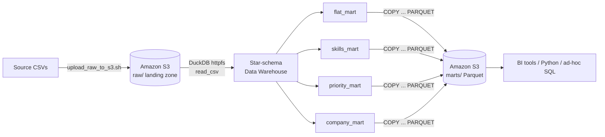

# 🏗️ Job Market Data Warehouse & Marts on AWS S3 + DuckDB

An end-to-end ELT pipeline that lands raw job-posting CSVs in **Amazon S3**, models them into a **star-schema data warehouse** in DuckDB, builds **four purpose-built data marts**, and publishes the marts back to S3 as **Parquet**. The whole pipeline is plain SQL, idempotent, and rebuilds with a single command.

---

## 🧾 At a Glance

| | |
|---|---|
| **Problem** | Raw job-posting data sits in flat CSVs, which makes skill-demand, salary and hiring-trend questions slow and inconsistent to answer |
| **Solution** | S3 landing zone → star-schema warehouse → specialised marts → Parquet serving layer on S3 |
| **Stack** | Amazon S3 · DuckDB · SQL · AWS CLI · Bash · Git |
| **Modelling** | Star schema, bridge tables, additive-measure fact tables, snapshot mart, flat denormalised mart |
| **Engineering** | Idempotent scripts, FK/integrity checks, `MERGE` incremental upserts, credential-chain auth (no secrets in code) |
| **Run it** | One command: `duckdb dw_marts.duckdb -c ".read build_dw_marts.sql"` |

---

## 🧩 Business Questions Answered

- Which skills are most in demand, and how is demand trending month over month?
- Which companies are hiring for which roles, in which countries?
- How do salaries, remote share and benefits vary by role and company?
- Which priority roles should a recruiter or job seeker focus on first?

---

## 🏛️ Architecture



**Why this design**
- **S3 as the landing and serving layer:** cheap, durable and tool-agnostic. Raw data and curated Parquet both live there.
- **DuckDB as the engine:** reads S3 directly and runs analytical SQL with no cluster to manage. Costs stay near zero while the design stays portable to Redshift, Athena or Snowflake.
- **Credential-chain auth:** DuckDB picks up credentials from the AWS CLI, environment variables, or an IAM role, so no keys are ever committed.
- **Private by default:** the upload script blocks all public access on the bucket.

---

## 🗄️ Data Model

### Warehouse (star schema)
`job_postings_fact` (one row per posting) with dimensions `company_dim` and `skills_dim`, joined many-to-many through the bridge table `skills_job_dim`. Primary and foreign keys are enforced and then verified with orphan-record checks.

### Marts

| Mart | Type | Grain | Purpose |
|---|---|---|---|
| `flat_mart` | Denormalised | 1 row per job posting | Fast ad-hoc queries. Skills are stored as an `ARRAY<STRUCT(type, name)>`, so no joins are needed |
| `skills_mart` | Dimensional | `skill + month + job_title_short` | Skill-demand trends. All measures are **additive counts**, so they can be re-aggregated safely |
| `priority_mart` | Snapshot + incremental | 1 row per priority job | Tracks priority roles. Refreshed with a single **`MERGE`** (insert, update and delete) |
| `company_mart` | Dimensional | `company + job_title + country + month` | Company hiring analysis with median/min/max salary and remote, benefits and no-degree shares |

---

## 📂 Repository Structure

```text
├── 00_setup_s3.sql              # DuckDB S3 extensions + credential-chain secret
├── upload_raw_to_s3.sh          # One-time: create private bucket, upload raw CSVs
├── 01_create_tables_dw.sql      # Star schema DDL
├── 02_load_schema_dw.sql        # Load from S3 + referential-integrity checks
├── 03_create_flat_mart.sql      # Denormalised mart
├── 04_create_skills_mart.sql    # Skill-demand mart (additive measures)
├── 05_create_priority_mart.sql  # Priority roles + jobs snapshot
├── 06_update_priority_mart.sql  # Incremental refresh with MERGE
├── 07_create_company_mart.sql   # Company hiring mart (bridge tables)
├── 08_export_marts_s3.sql       # Export marts to S3 as Parquet
└── build_dw_marts.sql           # Master script: runs everything in order
```

---

## 🚀 Quick Start

**Prerequisites:** [DuckDB CLI](https://duckdb.org/docs/installation), [AWS CLI](https://aws.amazon.com/cli/), and an AWS account with an IAM user limited to S3.

```bash
# 1. Authenticate (credentials stay on your machine)
aws configure

# 2. Create a private bucket and upload the raw CSVs
./upload_raw_to_s3.sh YOUR_BUCKET_NAME ap-south-1

# 3. Point the SQL at your bucket
sed -i 's/YOUR_BUCKET_NAME/<your-bucket>/g' 02_load_schema_dw.sql 08_export_marts_s3.sql
#    (on macOS use: sed -i '' ...)  and set REGION in 00_setup_s3.sql if different

# 4. Build the warehouse and all marts
duckdb dw_marts.duckdb -c ".read build_dw_marts.sql"
```

---

## 🔎 Example Queries

**Top skills by demand and remote share**
```sql
SELECT ds.skills,
       SUM(f.postings_count)                                  AS postings,
       ROUND(SUM(f.remote_postings_count) * 1.0
             / SUM(f.postings_count), 3)                      AS remote_share
FROM skills_mart.fact_skill_demand_monthly f
JOIN skills_mart.dim_skill ds USING (skill_id)
GROUP BY ds.skills
ORDER BY postings DESC
LIMIT 10;
```

**Query the published Parquet straight from S3 (no database needed)**
```sql
SELECT job_title_short, COUNT(*) AS postings
FROM read_parquet('s3://YOUR_BUCKET_NAME/marts/flat_mart/job_postings.parquet')
GROUP BY job_title_short
ORDER BY postings DESC;
```
---
